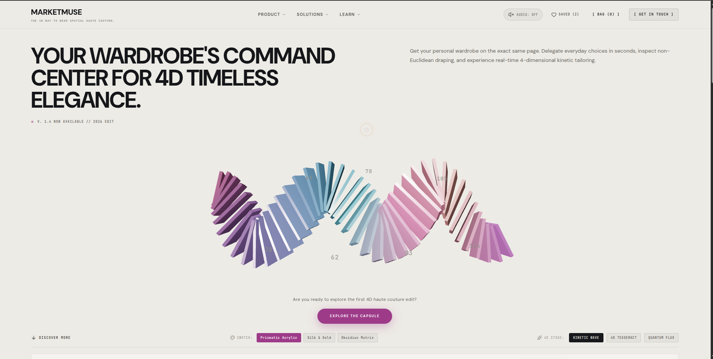

<div align="center">

# 🌌 MARKETMUSE

### **The 4D Way to Wear Spatial Haute Couture**

An avant-garde digital fashion concept and spatial eCommerce experience bridging non-Euclidean mathematics, real-time WebGL 3D/4D kinetic sculptures, procedural Web Audio synthesis, and luxury editorial design.

[](https://react.dev/)
[](https://www.typescriptlang.org/)
[](https://vitejs.dev/)
[](https://threejs.org/)
[](https://tailwindcss.com/)
[](LICENSE)

[Explore Features](#-key-features) • [4D Math Engine](#-4d-mathematics--rendering-engine) • [Live Demo & Quick Start](#-quick-start) • [Architecture](#-project-architecture) • [Sound Engine](#-web-audio-synthesizer)

---

</div>

## 📖 Table of Contents

- [Overview](#-overview)
- [Key Features](#-key-features)
  - [1. 4D Interactive Kinetic Stage](#1-4d-interactive-kinetic-stage)
  - [2. Chrono Dimension & Temporal Control](#2-chrono-dimension--temporal-control)
  - [3. Holographic 3D Product Inspector (4D Lab)](#3-holographic-3d-product-inspector-4d-lab)
  - [4. Gyroscopic 3D Product Cards](#4-gyroscopic-3d-product-cards)
  - [5. Procedural Web Audio Synthesizer](#5-procedural-web-audio-synthesizer)
  - [6. Spatial Commerce & Bag Drawer](#6-spatial-commerce--bag-drawer)
- [4D Mathematics & Rendering Engine](#-4d-mathematics--rendering-engine)
- [Tech Stack](#-tech-stack)
- [Project Architecture](#-project-architecture)
- [Quick Start](#-quick-start)
  - [Prerequisites](#prerequisites)
  - [Installation](#installation)
  - [Available Scripts](#available-scripts)
- [Configuration & Product Catalog](#-configuration--product-catalog)
- [Performance & Engineering Optimizations](#-performance--engineering-optimizations)
- [Contributing](#-contributing)
- [License](#-license)

---

## 🌟 Overview

**MarketMuse** redefines digital luxury and spatial fashion eCommerce. Traditional web shops present garments as flat, two-dimensional images. MarketMuse conceives fashion as a living, high-dimensional entity governed by time, curvature, and kinetic memory.

Built with **React 19**, **Three.js**, **React Three Fiber (R3F)**, **Framer Motion**, and **Tailwind CSS v4**, the application projects theoretical 4-dimensional forms ($X, Y, Z, W$) down to 3D viewports in real time. Visitors can sculpt non-Euclidean fabric waves, rotate a true 4D Tesseract across orthogonal hyper-planes, inspect modular garments in exploded holographic viewports, and listen to a custom Web Audio synthesizer responding to cursor velocity and spatial interactions.

---

## ✨ Key Features

### 1. 4D Interactive Kinetic Stage
The focal hero section houses an interactive WebGL canvas capable of switching between three distinct high-dimensional representations:
- **Kinetic Wave 3D**: A segmented kinetic wave consisting of 46 procedural cards deformed by harmonic 4D sinusoidal algorithms. Features interactive fabric swatches:
  - *Prismatic Acrylic* (chromatic dispersion with deep magenta/indigo stops)
  - *Silk & Gold* (warm camel, champagne silk, and luminous pearl)
  - *Obsidian Matrix* (stealth carbon, smoked glass, and electric violet accents)
  - Strumming cursor interaction that plays pentatonic notes as the mouse glides across the wave.
- **4D Tesseract (Hypercube)**: 16 vertices and 32 edges projected from 4-dimensional Euclidean hyperspace into 3D using dynamic $W$-perspective division.
- **Quantum Flux (Particle Singularity)**: A dense cloud of particles mapped using Hopf fibration mathematical models with real-time orbital velocity and relativistic dispersion.

### 2. Chrono Dimension & Temporal Control
The **Chrono Timeline** controls the temporal physics and aesthetics of the universe:
- **4 Epochs**:
  - `T-01: TITANIUM DAWN` — Warm golden and titanium hues.
  - `T-02: QUANTUM NOON` — Cold luminous azure and cyan spectra.
  - `T-03: CYBER AURORA` — Radiant emerald and bio-fluorescence.
  - `T-04: SINGULARITY VOID` — Deep monochrome space with amber solar highlights.
- **Warp Speed Regulator**: Smooth real-time frequency multiplier ($0.2\times$ to $3.0\times$) affecting wave oscillations, particle speeds, and tesseract rotation rates.
- **Live 4D Telemetry HUD**: Real-time vector readouts displaying $[X, Y, Z, W]$ hyperspace coordinates.

### 3. Holographic 3D Product Inspector (4D Lab)
Clicking on any piece launches an immersive spatial laboratory for microscopic structural inspection:
- **Procedural 3D Garments & Objects**: Custom geometries tailored for each category (`coat`, `gem`, `sneaker`, `bag`, `sculpture`, `ring`).
- **4 Dynamic Material Finishes**:
  - *Obsidian* (roughness: 0.1, clearcoat: 1.0, emissive indigo)
  - *Gold* (metallic: 0.98, warm gold specular)
  - *Quartz* (refractive transmission: 0.88, optical clarity)
  - *Titanium* (anodized finish with sharp highlights)
- **3 Kinematic Physics Modes**:
  - `STILL`: Static studio inspection mode.
  - `RUNWAY`: Oscillating drape physics simulating cat-walk gait and fabric inertia.
  - `ZERO-G`: Anti-gravity buoyant drift along three rotational axes.
- **Exploded View Mode**: Disassembles garments into separated architectural layers to showcase internal structural seams and lining.
- **Wireframe & Slicing Plane**: Renders topological polygon meshes and non-Euclidean planar intersections.

### 4. Gyroscopic 3D Product Cards
- **Perspective Tilt & Anisotropic Glare**: Cards track mouse coordinates with calculated 3D pitch/yaw transforms and a dynamic specular glare gradient.
- **Multi-Colorway Selector**: Interactive swatch dots to preview each piece in various textile editions (e.g., Camel, Obsidian, Ivory, Stone, Espresso, Chrome).
- **Fast Bag Add & Wishlist Pinning**: Single-click persistence with audio and visual feedback.

### 5. Procedural Web Audio Synthesizer
Zero external `.mp3` or `.wav` dependencies. MarketMuse contains a standalone, native **Web Audio API synthesizer**:
- **Ambient Drone**: Sub-bass sine wave ($55\text{ Hz}$) with low-pass filtering at $140\text{ Hz}$.
- **Kinetic Strum**: Warm two-octave pentatonic scale ($261.63\text{ Hz}$ to $1046.50\text{ Hz}$) triggered dynamically by card index during wave traversal.
- **Warp Sweep**: Resonant bandpass filter ($Q=3.5$) sweeping from $280\text{ Hz}$ to $2400\text{ Hz}$ with sawtooth oscillators.
- **Acoustic Haptic Clicks & Chimes**: High-frequency transients for interface buttons and celebratory multi-tone ascending arpeggios on bag additions.
- **Interactive Equalizer HUD**: Visual audio-spectrum indicator with instant master-mute toggle.

### 6. Spatial Commerce & Bag Drawer
- **Slide-out Cart & Wishlist Drawers**: Smooth Framer Motion transitions with backdrop blur.
- **Promo Code Engine**: Try voucher `4DLUXURY` or `MARKETMUSE` to unlock a **20% Chrono Voucher**.
- **Interactive 4D Cursor**: Custom dual-ring cursor with magnetic physics, lag interpolation, and state-aware hover scaling.
- **Haptic Toast Feedback**: Ephemeral notification toasts confirming spatial cart and wishlist displacements.

---

## 🔮 4D Mathematics & Rendering Engine

MarketMuse models objects with four spatial dimensions: $X$ (width), $Y$ (height), $Z$ (depth), and $W$ (ana/kata hyperspace vector).

### 4D to 3D Perspective Projection

To visualize a 4D object on a 3D viewport, vertices are transformed using a 4D camera placed at distance $d$:

```math
\text{factor} = \frac{d}{d - W}
```

```math
\begin{bmatrix} X_{3D} \\ Y_{3D} \\ Z_{3D} \end{bmatrix} = \begin{bmatrix} X_{4D} \cdot \text{factor} \\ Y_{4D} \cdot \text{factor} \\ Z_{4D} \cdot \text{factor} \end{bmatrix}
```

### Orthogonal 4D Rotation Matrices

The tesseract undergoes simultaneous rotations across orthogonal planes:
1. **$XW$ Plane (Hyper-rotation)**: Moves geometry through the fourth dimension.
2. **$XZ$ Plane (Standard spatial rotation)**: Rotates geometry within conventional 3D space.
3. **$XY$ Plane (Planar precession)**: Introduces gyroscopic orbital wobble.

---

## 🛠️ Tech Stack

| Domain | Technology | Description |
| :--- | :--- | :--- |
| **Core Framework** | [React 19](https://react.dev/) | Component architecture, state management, and modern hooks |
| **Language** | [TypeScript](https://www.typescriptlang.org/) | Strict type safety for complex 4D matrices and product schemas |
| **3D & WebGL** | [Three.js](https://threejs.org/) & [R3F](https://r3f.docs.pmnd.rs/) | Declarative WebGL scene graphs, cameras, and procedural meshes |
| **3D Helpers** | [@react-three/drei](https://github.com/pmndrs/drei) | `OrbitControls`, `Float`, `Html` overlays, and viewport utilities |
| **Styling** | [Tailwind CSS v4](https://tailwindcss.com/) | High-performance CSS engine with modern theme variables |
| **Animations** | [Framer Motion](https://www.framer.com/motion/) | Gestures, layout animations, and spring physics |
| **Audio** | [Web Audio API](https://developer.mozilla.org/en-US/docs/Web/API/Web_Audio_API) | Code-synthesized ambient drones, glissandos, and transients |
| **Icons** | [Lucide React](https://lucide.dev/) | Clean, minimalist luxury iconography |
| **Build Tool** | [Vite 8](https://vitejs.dev/) | Ultra-fast Hot Module Replacement and production bundling |
| **Linter** | [Oxlint](https://oxc.rs/) | Rust-powered high-speed JavaScript & TypeScript linter |

---

## 📁 Project Architecture

```
marketmuse/
├── public/
│   ├── favicon.svg             # Brand vector icon
│   └── icons.svg               # SVG asset definitions
├── src/
│   ├── assets/                 # Brand imagery and vector badges
│   ├── audio/
│   │   └── soundEngine.ts      # Web Audio API synthesizer (oscillators, filters, gain nodes)
│   ├── components/
│   │   ├── BagDrawer.tsx           # Cart drawer with promo code validation and checkout
│   │   ├── ChronoRibbon.tsx        # Dynamic 4D ribbon ribbon mesh component
│   │   ├── ChronoTimeline.tsx      # Epoch switcher, warp slider, and telemetry HUD
│   │   ├── Cursor4D.tsx            # Lag-interpolated spatial pointer with reactive state
│   │   ├── DimensionCanvas.tsx     # Master Three.js canvas hosting the 3D stages
│   │   ├── DimensionShowcase.tsx   # Atelier editorial showcase of the 4 engineering pillars
│   │   ├── KineticWave3D.tsx       # 46-slice wave sculpture with acoustic harp glissando
│   │   ├── ParticleSingularity.tsx # Hopf fibration quantum particle simulation
│   │   ├── ProductCard3D.tsx       # Gyro tilt card with dynamic anisotropic sheen
│   │   ├── ProductInspector3D.tsx  # 3D inspection modal (exploded view, materials, wireframe)
│   │   ├── SoundEqualizer.tsx      # Audio visualizer HUD & mute controller
│   │   ├── Tesseract4D.tsx         # 4D hypercube projected into 3D via W-division
│   │   └── WishlistDrawer.tsx      # Saved pieces drawer with one-click cart displacement
│   ├── data/
│   │   └── products.ts         # High-fashion catalog, 4D coordinates, and specifications
│   ├── App.css                 # Component-level layout styles
│   ├── App.tsx                 # Root application state & composition
│   ├── index.css               # Design tokens, luxury typography, and Tailwind v4 directives
│   └── main.tsx                # React DOM entrypoint
├── package.json
├── tsconfig.json
└── vite.config.ts
```

---

## 🚀 Quick Start

### Prerequisites
- **Node.js**: `v18.0.0` or higher (Node.js 20+ recommended)
- **Package Manager**: `npm`, `pnpm`, or `yarn`

### Installation

1. **Clone the repository**:
   ```bash
   git clone https://github.com/Hayat373/marketmuse.git
   cd marketmuse
   ```

2. **Install dependencies**:
   ```bash
   npm install
   ```

3. **Launch the development server**:
   ```bash
   npm run dev
   ```
   Open your browser and navigate to `http://localhost:5173`.

### Available Scripts

| Command | Action |
| :--- | :--- |
| `npm run dev` | Starts the Vite local development server with HMR |
| `npm run build` | Type-checks with `tsc -b` and bundles for production |
| `npm run preview` | Locally serves the optimized production build |
| `npm run lint` | Runs the high-performance Oxlint linter |

---

## 🎧 Web Audio Synthesizer

MarketMuse features a fully self-contained Web Audio engine located in `src/audio/soundEngine.ts`. It requires zero external audio media files, keeping bandwidth low and latency under `0.4ms`.

```typescript
import { sound } from "./audio/soundEngine";

// Toggle synthesizer on/off
sound.toggle();

// Play custom synthesized soundscapes
sound.playHover();                    // High-frequency subtle blip
sound.playStrum(cardIndex, total);    // Pentatonic harmonic harp tone
sound.playWarp();                     // Resonant bandpass frequency sweep
sound.playAddBag();                   // Ascending celebratory 4-tone chord
sound.playInspect();                  // Exponentially sweeping sine wave
```

---

## 👗 Configuration & Product Catalog

Products are defined in `src/data/products.ts` with strict TypeScript types:

```typescript
export type Product = {
  id: number;
  name: string;
  category: string;
  price: number;
  color: string;
  image: string;
  position: [number, number, number];
  description: string;
  tag?: string;
  coord4D: [number, number, number, number]; // [X, Y, Z, W] in hyperspace
  chronoEpoch: string;
  geometryType: "coat" | "gem" | "sneaker" | "bag" | "sculpture" | "ring";
  materialFinish: string;
  specifications: string[];
};
```

To add a new piece to the collection, append a new object conforming to the `Product` schema in `products.ts`. The 3D inspector will automatically instantiate the appropriate procedural geometry and coordinate transforms.

---

## ⚡ Performance & Engineering Optimizations

- **Dynamic Device Pixel Ratio**: `dpr={[1, 2]}` limits rendering overhead on Ultra-HD/Retina displays.
- **Typed Float32Array Buffers**: All dynamic line segments and particle attributes update in-place using pre-allocated typed arrays, avoiding garbage collection pauses during animation frames.
- **Suspense-Bound Rendering**: 3D canvases are wrapped in React `Suspense` with non-blocking fallbacks.
- **GPU Accelerated Transitions**: Card tilts and drawer transitions rely exclusively on GPU-composited CSS transforms and Framer Motion spring physics.
- **Modular Code Organization**: Clear boundaries between 3D scene graphs, audio synthesis, and standard DOM eCommerce elements.

---

## Preview



---

## 🤝 Contributing

Contributions are welcome! If you'd like to improve the 4D mathematics, introduce new procedural garment geometries, or refine the sound engine:

1. Fork the Project (`https://github.com/Hayat373/marketmuse/fork`)
2. Create your Feature Branch (`git checkout -b feature/Amazing4DFeature`)
3. Commit your Changes (`git commit -m 'Add some Amazing4DFeature'`)
4. Push to the Branch (`git push origin feature/Amazing4DFeature`)
5. Open a Pull Request

---

## Live Demo

[Open Pulseboard](https://marketmuse-mnu5x7vab-hayats-projects-e4ba8944.vercel.app/)

--- 

## 📜 License

Distributed under the **MIT License**. See `LICENSE` for more information.

---

<div align="center">

Designed & Engineered by **[Hayat](https://github.com/Hayat373)**

*MarketMuse © 2026 // High-Dimensional Fashion // All Dimensions Reserved.*

</div>
